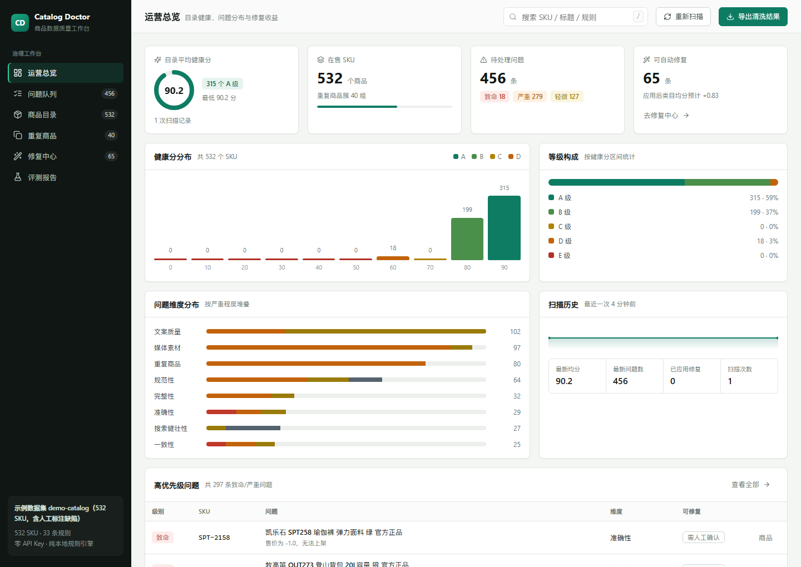
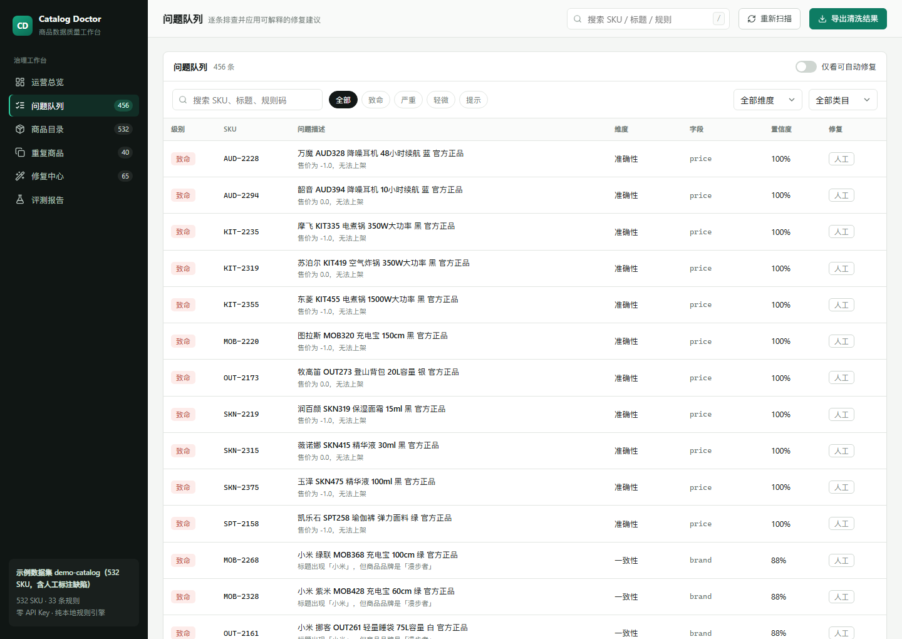
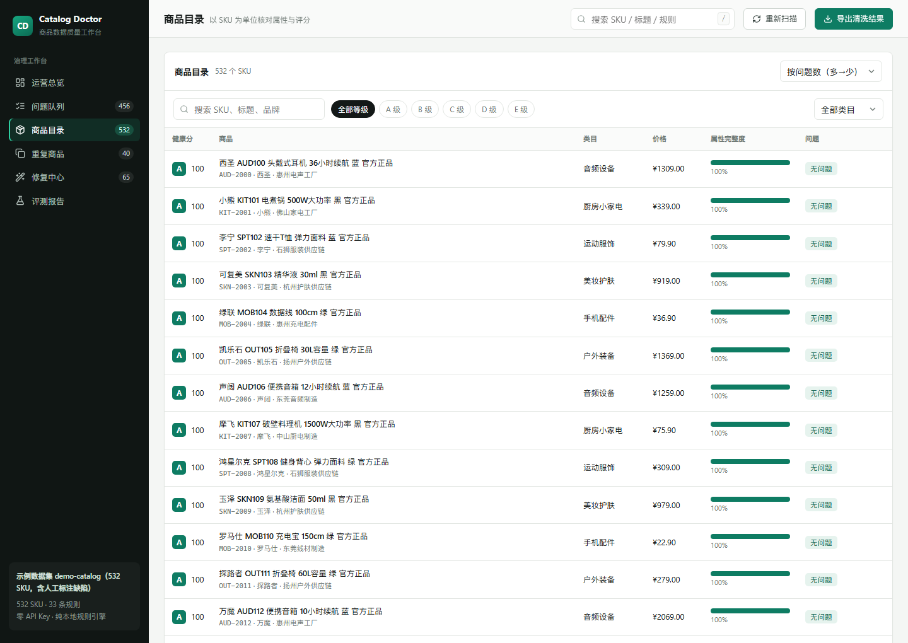
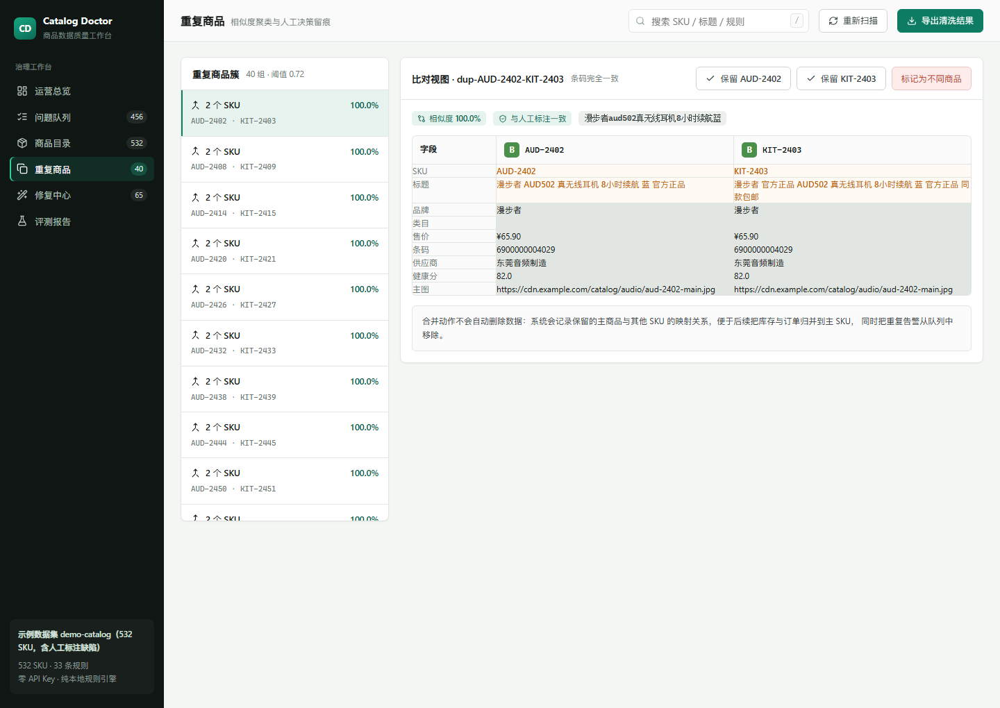
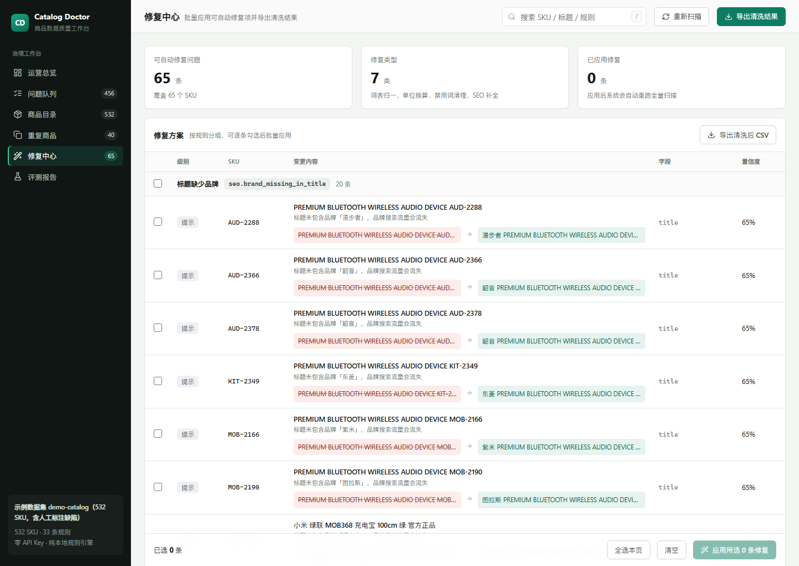
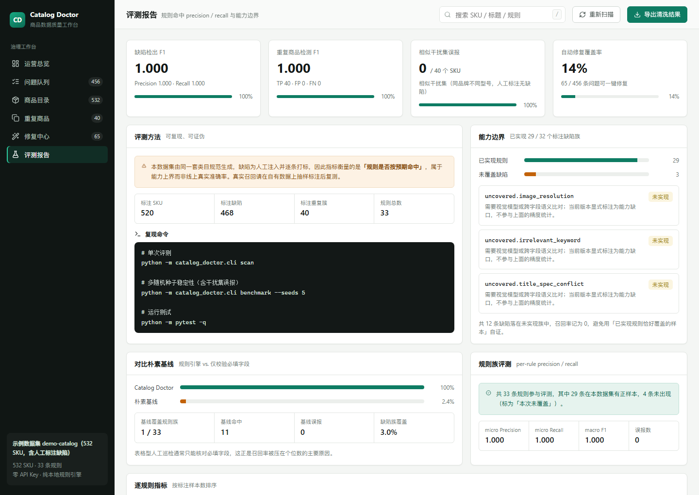

# Catalog Doctor · 商品数据质量治理工作台

一个从零实现的、面向电商中台/自营商城的**商品数据质量引擎**：用可声明的类目质量契约扫描商品库，输出可解释的问题清单、健康分、重复商品聚类与一键修复，并附带一套可复现的评测基线来证明它到底有多准。

[](LICENSE)
[](pyproject.toml)
[](#质量规则清单)
[](#快速开始)

后端 FastAPI + 纯标准库规则引擎，前端 React 19 + TypeScript + Vite。全流程零外部服务、零 API Key，`git clone` 之后本机即可跑通。

---

## 它解决什么问题

商品库一旦上规模，坏数据的形态总是重复出现：

- **必填属性缺失**：类目不同，必填字段也不同，用一张全局表校验必然漏判。
- **单位与枚举混用**：`500ml` / `0.5L` / `500 毫升` 并存，筛选和比价直接失效。
- **价格非法或离群**：`-1`、`0`、比类目区间高两个数量级，前端展示和风控都会炸。
- **标题污染**：广告法禁用词、关键词堆砌、促销符号、占位文案残留。
- **重复铺货**：同一商品换个 SKU 编码、改两个字重新上架，人工肉眼很难清干净。
- **修了不知道有没有效**：没有评测基线，就无法回答"规则到底准不准、还会漏什么"。

Catalog Doctor 把上面这些拆成可执行、可度量、可回滚的三件事：**扫描 (Scan) → 修复 (Repair) → 评测 (Evaluate)**。

---

## 界面预览

<table>
  <tr>
    <td width="50%"><br><sub>运营总览：健康分、问题分布、类目健康度、扫描历史</sub></td>
    <td width="50%"><br><sub>问题队列：按维度/类目/严重度筛选，逐条排查</sub></td>
  </tr>
  <tr>
    <td width="50%"><br><sub>商品目录：以 SKU 为单位核对属性、完整度与得分</sub></td>
    <td width="50%"><br><sub>重复商品：相似度聚类与字段级并排比对</sub></td>
  </tr>
  <tr>
    <td width="50%"><br><sub>修复中心：修复前后对照，可勾选批量应用</sub></td>
    <td width="50%"><br><sub>评测报告：precision / recall、基线对比与能力边界</sub></td>
  </tr>
</table>

视图支持深链接，例如 `http://127.0.0.1:8010/#/duplicates` 可直接打开重复商品页。

---

## 核心能力

1. **按类目声明的质量契约**
   每个类目声明自己的属性集（类型、是否必填、单位、枚举词表、数值区间）。同一份规则跑 6 个类目，判据来自类目本身，而不是硬编码的全局字段表。

2. **33 条规则 / 8 个维度**
   完整性、规范性、准确性、一致性、文案质量、媒体素材、搜索健壮性、重复商品。每条规则携带机器可读的 `code`、严重度、维度与人类可读的解释。

3. **纯标准库的近重复检测**
   TF-IDF（3-gram 字符 shingle）+ 型号数字差异惩罚 + 规格/价格冲突惩罚 + GTIN 条码强提升，用并查集聚类，默认阈值 `0.72`。没有向量数据库，也没有外部模型调用。

4. **可解释、可审计的修复**
   `replace_value` / `convert_unit` / `strip_html` 三类原子修复，先给"修复前 → 修复后"对照，再批量应用；每次应用落地审计记录，应用后自动重跑全量扫描。

5. **自带评测与能力边界**
   数据集内置人工标注缺陷、40 组重复商品真值，以及 40 个"同品牌不同型号"的相似干扰样本（用来度量误报）。同时刻意保留 3 个**未实现**的缺陷族，单独暴露能力上界。

6. **运营向前端**
   零依赖图表（SVG）、抽屉式问题详情、重复商品字段级 diff、批量修复工作台，全部基于真实接口数据渲染。

---

## 快速开始

环境要求：Python 3.10+、Node.js 20+（仅前端开发需要）。

### 1. 后端依赖

```bash
python -m venv .venv
# Windows: .venv\Scripts\activate    macOS/Linux: source .venv/bin/activate
pip install -e ".[dev]"
```

### 2. 构建前端

```bash
cd frontend
npm install
npm run build    # 产物写入 frontend/dist，由后端直接托管
```

只想改 UI 时改用 `npm run dev`（<http://127.0.0.1:5173>，`/api` 自动代理到 8010）。

### 3. 启动服务

```bash
uvicorn catalog_doctor.api:app --host 127.0.0.1 --port 8010
```

打开 <http://127.0.0.1:8010/> 即可看到工作台；接口文档在 `/docs`。暂时不构建前端也不影响 `/api/v1/*` 与 `/docs` 使用。

### 4. 命令行

```bash
python -m catalog_doctor.cli scan                 # 单次扫描 + 评测报告
python -m catalog_doctor.cli benchmark --seeds 5  # 多随机种子稳定性评测
python -m catalog_doctor.cli export --out catalog.csv
python -m catalog_doctor.cli serve --port 8010    # 等价于 uvicorn 启动
```

### 5. 测试

```bash
python -m pytest -q     # 85 passed
```

---

## 演示数据集

仓库内置 `demo-catalog`（`catalog_doctor/ingest.py` 中的生成器），**全部为合成数据**，可复现、无版权风险：

| 项目 | 数值 |
| --- | --- |
| 商品数 | 532 SKU，覆盖 6 个类目 |
| 人工标注 SKU | 520 |
| 人工标注缺陷 | 468 条（逐一打上规则 code） |
| 重复商品真值 | 40 组 |
| 相似干扰样本 | 40 个（同品牌不同型号，标注为无缺陷） |
| 刻意未实现的缺陷族 | 3 个（12 条缺陷，单独统计） |

数据里包含 35 个合成品牌、真实风格的属性名与单位、多规格商品、条码校验位、图片地址等字段，缺陷按固定随机种子注入，因此任何一次运行的结论都可复现。

---

## 质量规则清单

33 条规则按维度分布：文案 8、规范性 6、媒体 6、完整性 3、准确性 3、一致性 3、搜索健壮性 2、重复商品 2。

| 维度 | 严重度 | 规则 code | 说明 |
| --- | --- | --- | --- |
| 完整性 | major | `completeness.required_attribute` | 类目必填属性缺失 |
| 完整性 | major | `completeness.missing_brand` | 品牌缺失 |
| 完整性 | minor | `completeness.missing_barcode` | 条码缺失 |
| 规范性 | major | `conformance.enum_value_invalid` | 枚举值不规范 |
| 规范性 | major | `conformance.numeric_not_parseable` | 数值不可解析 |
| 规范性 | major | `conformance.numeric_out_of_range` | 数值超出合理区间 |
| 规范性 | minor | `conformance.unit_mismatch` | 计量单位不统一 |
| 规范性 | major | `conformance.barcode_checksum` | 条码校验位错误 |
| 规范性 | info | `conformance.unknown_attribute` | 未声明属性 |
| 准确性 | critical | `accuracy.price_invalid` | 价格非法（负数/零/不可解析） |
| 准确性 | major | `accuracy.price_out_of_band` | 价格超出类目区间 |
| 准确性 | major | `accuracy.price_outlier` | 价格离群 |
| 一致性 | critical | `consistency.brand_conflict` | 标题品牌与品牌字段冲突 |
| 一致性 | major | `consistency.variant_axis_missing` | 规格轴缺失或重复 |
| 一致性 | minor | `consistency.variant_price_inconsistent` | 规格价格异常 |
| 文案质量 | major | `text.title_length` | 标题长度异常 |
| 文案质量 | major | `text.banned_word` | 广告法禁用词 |
| 文案质量 | minor | `text.promo_noise` | 促销符号污染 |
| 文案质量 | minor | `text.keyword_stuffing` | 关键词堆砌 |
| 文案质量 | minor | `text.all_caps` | 全大写标题 |
| 文案质量 | major | `text.description_too_short` | 详情过短 |
| 文案质量 | major | `text.placeholder_text` | 占位文案残留 |
| 文案质量 | minor | `text.raw_html` | 未渲染 HTML |
| 媒体素材 | critical | `completeness.missing_image` | 图片缺失 |
| 媒体素材 | minor | `media.image_count_low` | 图片数量不足 |
| 媒体素材 | major | `media.image_url_invalid` | 图片地址非法 |
| 媒体素材 | info | `media.image_generic_filename` | 图片命名不规范 |
| 媒体素材 | info | `media.image_alt_missing` | 图片缺少 alt |
| 媒体素材 | major | `media.image_shared_asset` | 主图复用 |
| 搜索健壮性 | minor | `seo.keywords_missing` | 搜索关键词缺失 |
| 搜索健壮性 | info | `seo.brand_missing_in_title` | 标题缺少品牌 |
| 重复商品 | major | `duplication.exact_title` | 标题完全重复 |
| 重复商品 | major | `duplication.near_duplicate` | 近似重复商品 |

### 评分模型

健康分从 100 分开始扣：`严重度基准分 × 维度权重`，单维度扣分上限 42 分，避免一个字段组把 SKU 压到 0；重复商品另有上限 24 分。等级区间 A ≥ 90、B ≥ 78、C ≥ 64、D ≥ 48、E < 48，并对致命问题设置等级天花板（出现 critical 的商品最高只能到 60 分）。

---

## 评测结果

在内置标注数据集上的实测（`python -m catalog_doctor.cli scan`）：

| 指标 | 数值 | 说明 |
| --- | --- | --- |
| 缺陷检出 micro P / R / F1 | 1.000 / 1.000 / 1.000 | 456 个真值缺陷，命中 456，误报 0 |
| 重复商品 P / R / F1 | 1.000 / 1.000 / 1.000 | 40 组真值，阈值 0.72 |
| 相似干扰集误报 | 0 / 40 SKU | 同品牌不同型号，刻意易混 |
| 朴素基线召回 | 0.0241 | 仅校验必填字段，覆盖 1/33 条规则 |
| 可自动修复覆盖率 | 65 / 456 条（14.3%） | 其余需人工确认或补齐素材 |
| 目录平均健康分 | 90.2 | A 315 / B 199 / D 18 |

多随机种子稳定性（`python -m catalog_doctor.cli benchmark --seeds 5`）：

```
seed=20261011  缺陷 P=1.000 R=1.000 F1=1.000 | 重复 P=1.000 R=1.000 F1=1.000 | 干扰集误报=0
seed=20261012  缺陷 P=1.000 R=1.000 F1=1.000 | 重复 P=1.000 R=1.000 F1=1.000 | 干扰集误报=0
seed=20261013  缺陷 P=1.000 R=1.000 F1=1.000 | 重复 P=1.000 R=1.000 F1=1.000 | 干扰集误报=0
seed=20261014  缺陷 P=1.000 R=1.000 F1=1.000 | 重复 P=1.000 R=1.000 F1=1.000 | 干扰集误报=0
seed=20261015  缺陷 P=1.000 R=1.000 F1=1.000 | 重复 P=1.000 R=1.000 F1=1.000 | 干扰集误报=0
```

### 这些数字该怎么读

**上面的满分是"能力上界"，不等于线上准确率。** 数据集由同一套类目规范生成，缺陷是人为注入并逐条打标的，规则与标注出自同一份契约，因此这套指标衡量的是"规则是否按预期命中"，用来防回归，而不是真实业务上的泛化能力。真实召回需要在自有数据上抽样标注后复测。

为了不美化结论，报告里同时给出两件事：

- **相似干扰集**：40 个容易被误判的商品，用来盯住误报（F1 满分很容易靠"多报"刷出来，这里堵住这个口子）。
- **能力边界**：3 个缺陷族（`uncovered.image_resolution`、`uncovered.irrelevant_keyword`、`uncovered.title_spec_conflict`）**刻意不实现**，共 12 条缺陷在实现规则族中的召回为 0。它们需要视觉模型或跨字段语义比对，当前版本显式标注为能力缺口，并排除在精度指标之外。

---

## HTTP API

| 方法 | 路径 | 说明 |
| --- | --- | --- |
| GET | `/api/v1/health` | 健康检查与数据集标识 |
| GET | `/api/v1/meta` | 类目、属性规范、维度与规则元数据 |
| GET | `/api/v1/summary` | 总览：健康分、分布、类目健康度、扫描历史 |
| GET | `/api/v1/products` | 商品列表（搜索、类目、等级、排序、分页） |
| GET | `/api/v1/products/{sku}` | 单品详情、属性与逐条问题 |
| GET | `/api/v1/issues` | 问题队列（维度、严重度、类目、仅看可修复） |
| GET | `/api/v1/duplicates` | 重复商品聚类与聚类内差异 |
| POST | `/api/v1/duplicates/resolve` | 人工决策：保留某个 SKU / 标记为不同商品 |
| GET | `/api/v1/repairs` | 待修复方案（按规则分组，含前后对照） |
| POST | `/api/v1/repairs/apply` | 应用单个 SKU 的指定问题修复 |
| POST | `/api/v1/repairs/apply-bulk` | 批量应用并返回分数变化 |
| GET | `/api/v1/eval` | 评测报告：逐规则指标、基线、干扰集、能力边界 |
| POST | `/api/v1/scan` | 重新扫描（可传入自定义商品集合） |
| POST | `/api/v1/upload` | 上传 CSV 覆盖当前数据集 |
| GET | `/api/v1/export.csv` | 导出清洗后的商品 CSV |

---

## 架构

```
CSV / 内置数据集
        │
        ▼
   ingest.py          解析、类型推断、字段映射
        │
        ▼
  taxonomy.py         类目与属性契约（类型/必填/单位/枚举/区间）
        │
        ├──► rules/    完整性 规范性 准确性 一致性 文案 媒体 SEO 重复
        │       └── context.py 提供属性解析、单位换算、词表归一
        │
        ├──► duplicates.py   3-gram TF-IDF + 惩罚项 + 并查集聚类
        │
        ▼
  scoring.py          维度加权扣分 → 健康分 / 等级 / 维度得分
        │
        ├──► repair.py   原子修复 + 审计日志 + 重扫
        └──► eval.py     与人工标注对比 → precision / recall / 基线 / 能力边界
        │
        ▼
   service.py  ──►  api.py (FastAPI)  ──►  frontend/ (React 运营工作台)
                └►  cli.py  (scan / benchmark / export / serve)
```

```
catalog-doctor/
├── catalog_doctor/
│   ├── models.py       数据模型、维度权重、等级区间
│   ├── taxonomy.py     6 个类目的属性契约与枚举词表
│   ├── ingest.py       数据集生成与 CSV 摄入
│   ├── rules/          33 条规则的实现与规则上下文
│   ├── duplicates.py   近重复检测与聚类
│   ├── scoring.py      健康分与维度得分
│   ├── repair.py       修复方案与审计
│   ├── eval.py         评测与基线
│   ├── service.py      领域服务层（API 与 CLI 共用）
│   └── api.py          FastAPI 应用
├── tests/              85 个测试（规则、重复检测、评分、修复、API）
├── frontend/           React 19 + TypeScript + Vite 工作台
├── docs/screenshots/   README 配图
├── NOTICE              第三方灵感来源与许可说明
└── LICENSE             MIT
```

---

## 设计取舍

- **不用大模型也能干活**：规则引擎覆盖的问题类型里，可解释性和可回滚性比"更聪明"更重要。需要语义理解的缺陷（图片分辨率、无关关键词、标题与规格矛盾）在评测里显式列为未实现，而不是用模糊判断伪装成已覆盖。
- **纯标准库实现重复检测**：不引入向量库，`O(n²)` 的成对比较在 532 SKU 上毫秒级完成；真实规模需要改为分桶召回，这一点写在路线图里。
- **修复必须留痕**：所有自动修复都记录 before/after 与规则来源，重复商品合并不删除数据，只记录主商品与其他 SKU 的映射关系。
- **前端不引重型图表库**：柱状、堆叠、环形、迷你趋势图都是手写 SVG，构建产物为 CSS 18.7 kB / JS 292.5 kB（gzip 后约 4.7 kB / 88 kB）。

## 已知局限

- 重复检测是成对全量比较，商品数上到几万需要先做相似分桶。
- 中文标题只做了字符级 shingle，没有分词与同义词归一，跨品牌同款的召回会下降。
- 单位换算覆盖常见公制单位，未处理英制与复合单位（如 `30cm x 20cm`）。
- 评测数据是同源合成数据，指标是回归防线，不是线上效果承诺。

---

## 灵感来源

本项目为**完全原创实现**，未复制任何第三方源码。下面这些高星开源项目在领域建模上提供了参考，逐条记录在 [NOTICE](NOTICE) 中：

| 项目 | 借鉴的点 |
| --- | --- |
| [Bagisto](https://github.com/bagisto/bagisto)（MIT） | 按类目声明属性集，必填字段随类目变化 |
| [django-oscar](https://github.com/django-oscar/django-oscar)（BSD-3-Clause） | 目录结构与库存/价格关注点分离 |
| [Saleor](https://github.com/saleor/saleor)（BSD-3-Clause） | 属性类型驱动校验，校验错误带机器可读 code |
| [dotnet/eShop](https://github.com/dotnet/eShop)（MIT） | 分层参考架构，领域规则与传输层解耦 |
| [marqo-ai/marqo](https://github.com/marqo-ai/marqo)（Apache-2.0） | 近重复商品是噪声文本上的匹配问题 |
| [Aimeos](https://github.com/aimeos/aimeos-laravel)（MIT） | 属性"必填/可选"类型直接反映到后台体验 |

数据集、品牌名、类目词表与全部代码均为本项目原创或合成，不使用任何真实企业数据。

---

## 路线图

- [ ] 相似度分桶（MinHash / LSH）以支持十万级 SKU
- [ ] 中文分词与同义词归一，提升跨品牌同款召回
- [ ] 图片可用性巡检（尺寸、清晰度、重复主图检测）
- [ ] 修复回滚与审批流，接入真实商品库前先做灰度
- [ ] 导出 PDF/Excel 治理周报

## 许可证

[MIT](LICENSE)
